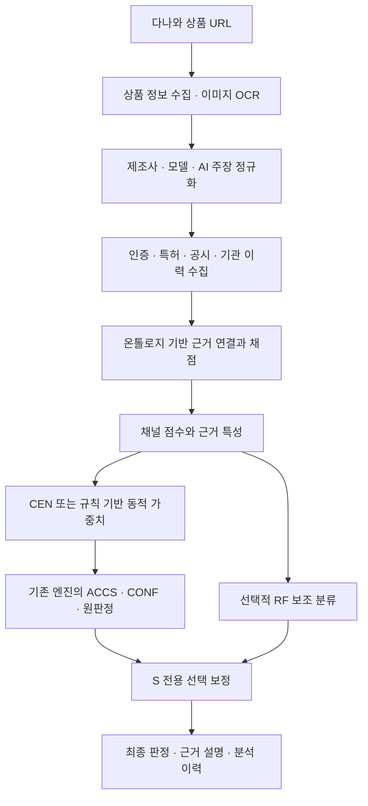

# Fides — AI 워싱 탐지 시스템

**상품이 내세우는 AI 기능을 공개 근거와 대조하고, 판단의 근거를 함께 보여주는 서비스입니다.**

다나와 상품 URL을 입력하면 상품 설명과 이미지에서 AI 관련 주장을 추출하고, 인증·특허·공시·공공기관 이력과 연결해 분석합니다. 온톨로지 기반 평가 엔진을 중심으로 제품별 가중치 모델과 Suspicious 전용 보조 분류를 결합합니다.

## 🌐 서비스 이용

### [Fides 서비스 바로가기 → http://3.39.41.117:3000](http://3.39.41.117:3000)

AWS에 배포된 웹 서비스에서 상품 URL을 입력해 분석할 수 있습니다. 로그인하면 분석 이력과 관심 상품을 관리하고, 저장한 제품의 결과를 비교할 수 있습니다.

## 프로젝트 소개

AI 워싱은 실제 AI 기술이나 기능에 비해 AI 활용을 과장하거나, 충분한 근거 없이 AI 제품으로 홍보하는 현상입니다. 소비자가 상품 설명만으로 기술 적용 여부와 관련 근거를 확인하기는 어렵습니다.

Fides는 **상품의 AI 주장, 기능에 필요한 구성요소, 확인된 외부 근거 사이의 관계**를 구조화합니다. 단순히 ‘AI’라는 단어의 등장 여부로 판단하지 않고 다음 내용을 평가합니다.

- 상품이 어떤 AI 기능을 주장하는가?
- 해당 기능에 필요한 기술·구성요소는 무엇인가?
- 이를 뒷받침하는 인증·특허·공시·기관 기록이 있는가?
- 그 근거는 해당 제품·모델과 얼마나 직접적으로 연결되는가?

## 주요 기능

| 기능 | 내용 |
|---|---|
| URL 기반 상품 분석 | 다나와 상품 페이지와 상세 이미지에서 제품 정보와 AI 관련 표현을 수집합니다. |
| 근거 교차 확인 | 인증, 특허, 기업 공시, 기관·조달 이력을 제품·모델·기업 정보와 연결합니다. |
| 주장별 근거 설명 | 감지된 AI 기능, 충족된 구성요소, 부족한 요건, 관련 출처를 제시합니다. |
| 종합 평가 | 정상(G), 의심(S), 워싱(W) 판정과 채널 점수·위험도를 제공합니다. |
| 분석 진행 표시 | SSE와 진행 조회 API로 분석 상태를 전달합니다. |
| 결과 관리 | 분석 이력, 폴더, 관심 목록, 제품 비교와 대시보드를 지원합니다. |

## 시스템 구조



### 1. 상품 정보와 AI 주장 수집

Selenium과 OCR로 상품 설명·스펙·이미지의 텍스트를 수집합니다. 웹 분석 경로에서는 Gemini를 활용한 OCR 텍스트 정제도 수행합니다. 제조사와 모델 표기를 정리해 외부 기록 검색과 제품 연결에 사용합니다.

### 2. 온톨로지 기반 평가

온톨로지는 **AI 기능(capability), 기능에 필요한 구성요소, 관련 표현, 인정할 수 있는 근거**의 관계를 정의합니다. 엔진은 상품에서 감지한 주장과 실제로 확인된 근거를 이 구조에 대조합니다.

근거를 연결할 때는 정확한 모델 일치, 제품 수준 일치, 같은 제품군, 기업의 관련 기술 이력 등을 구분합니다. 기업이 보유한 특허나 인증이 있다는 사실만으로 특정 제품의 기능 전체가 입증된 것으로 처리하지 않습니다. 중복 출처와 근거의 직접성·다양성·최신성도 함께 반영합니다.

### 3. 채널 점수와 종합 점수

| 지표 | 평가하는 내용 |
|---|---|
| **HES** | 하드웨어·제품 실체와 공인 인증 관련 근거 |
| **TES** | 특허·공시 등 AI 기능의 기술적 근거 |
| **CES** | 인증·공공기관·조달 등 외부 기관 이력과 맥락 근거 |
| **ECS** | 근거 채널의 다양성 |
| **CONF** | 엔진이 산출하는 분석 신뢰도 지표 |
| **ACCS** | 채널 점수와 가중치를 결합한 종합 평가 점수 |

현재 기본 ACCS 산식은 다음과 같습니다.

```text
ACCS = 0.85 × (wH × HES + wT × TES + wC × CES) + 0.15 × ECS
```

채널 가중치는 0 이상이며, 사용 가능한 채널의 가중치 합은 1입니다. 학습된 CEN이 연결되어 있으면 제품의 근거 품질과 제품군에 따라 가중치를 생성하고, 그렇지 않으면 기존 규칙 기반 동적 가중치를 사용합니다.

엔진의 ACCS는 0~100 범위의 평가 점수입니다. 화면에는 별도의 표시용 변환 점수가 사용될 수 있으며, 판정 기준은 엔진 ACCS를 따릅니다. **ACCS와 CONF는 ‘실제 AI 제품일 확률’을 의미하지 않습니다.**

## CEN과 랜덤포레스트의 역할

| 구성 | 역할 | 출력 |
|---|---|---|
| 온톨로지 엔진 | 상품 주장과 수집 근거의 관계·충족도를 평가 | 채널 점수, 근거 특성, 설명 |
| CEN 가중치 모델 | 근거 품질·제품군·채널 마스크에 따라 채널 비중 생성 | HES·TES·CES 가중치 |
| 기존 판정 로직 | 점수·가중치·근거 충분도·CONF를 결합 | ACCS와 원판정 |
| RF 보조모델 | 기존 분석 지표로 W·S·G를 추가 분류 | 클래스별 예측 점수 |
| S 전용 보정 정책 | 원판정과 RF 결과의 변경 조건을 확인 | 최종 판정과 보정 이력 |

CEN은 점수를 결합할 **비중**을 학습하고, RF는 기존 엔진이 놓친 의심 제품을 보완하도록 **분류**합니다. SENN은 CEN 학습에서 가중치의 안정성을 돕는 정규화 항입니다.

RF는 여러 결정트리의 예측을 합치는 랜덤포레스트입니다. 입력은 HES·TES·CES·ECS 4개, 채널 마스크 3개, 근거 특성 15개와 제품군입니다. 온톨로지 엔진이 만든 분석 지표를 활용하지만, RF 자체가 온톨로지 규칙을 추론하는 모델은 아닙니다. 기존 근거 설명은 유지하고, RF에 의한 판정 변경은 별도 이력으로 구분합니다.

### S 전용 선택 보정

다음 조건을 **모두** 충족할 때만 최종 판정을 Suspicious로 변경합니다.

1. 기존 엔진의 원판정이 **Washing 또는 Genuine**입니다.
2. RF가 예측한 세 클래스 중 **Suspicious의 확률값이 가장 높습니다.**
3. **Suspicious 예측 점수가 0.55 이상**입니다.

```text
기존 W/G + RF의 최다 확률 클래스 S + S 점수 ≥ 0.55 → 최종 S
그 외 → 기존 판정 유지
```

이 정책은 W↔G 판정을 서로 바꾸지 않으며, 기존 S·평가 제외 결과도 유지합니다. ACCS, 원점수, HES/TES/CES/ECS, CONF와 CEN 가중치는 변경하지 않습니다. 보정이 적용되면 최종 위험도는 ‘중간’으로 표시하고 추가 확인 안내를 제공합니다.

따라서 높은 점수의 제품도 보조 분류에서 의심 신호가 발견되면 최종 S로 표시될 수 있습니다. 0.55는 보정 적용을 위한 모델 확률값의 기준이며, 분류 정확도나 보정된 신뢰도를 뜻하지 않습니다.

## 판정과 결과 해석

| 분류 | 엔진 표현 | 의미 |
|---|---|---|
| **G — Genuine** | Normal / Credible | 현재 확인된 근거와 평가 기준에서 정상·신뢰 구간에 해당 |
| **S — Suspicious** | Suspected | 추가 확인이 필요한 의심 구간 또는 S 전용 보정 대상 |
| **W — Washing** | Washing | 현재 평가 기준에서 AI 워싱 위험이 높은 구간 |

기존 엔진은 ACCS와 근거 충분도로 Normal·Credible 여부를 먼저 판단하고, 이어 ACCS와 CONF로 Suspected·Washing을 구분합니다. 기본 ACCS 경계는 21.8 / 35.0 / 67.5이며, 전체 조건은 [`fides_config.py`](fides_config.py)와 [`analysis_engine.py`](analysis_engine.py)에 정의되어 있습니다. 최종 결과에는 S 전용 보정이 추가로 적용될 수 있습니다.

분석 결과에서는 종합 점수 외에도 주장별 근거, 부족한 구성요소, 출처, 채널 가중치와 기여도를 확인할 수 있습니다. 보정 이력의 `s_only_correction`에는 원판정·최종 판정, S 예측 점수, 적용 기준과 모델 버전이 기록됩니다.

근거가 적은 이유는 기술 부재뿐 아니라 공개 정보의 부족, 모델명 불일치, 조회 실패일 수도 있습니다. 결과는 수집 시점에 확인한 자료를 바탕으로 한 검토 자료이며, 제품의 실제 구현 전체를 직접 검사한 결과는 아닙니다.

## S 전용 보정 모델과 개발 실험

포함된 RF 모델은 제품 **1,152개**(G 922 / W 193 / S 37), 제품군 **40개**로 재학습한 배포용 모델입니다. 트리 200개, 최대 깊이 6, 잎 최소 표본 5, seed 42를 사용하며, 클래스 불균형은 `sqrt(N / (3 × 클래스 표본 수))` 가중치로 보완합니다.

이전 개발 실험에서 제품군을 입력하고 모델 계열을 분리한 5-fold 교차검증 결과는 다음과 같습니다.

| 방식 | 정확도 | Macro-F1 | S 탐지 / 전체 S | S 정밀도 |
|---|---:|---:|---:|---:|
| 기존 엔진 | 84.64% | 0.5222 | 0 / 37 | 0.00% |
| 기존 엔진 + S 전용 선택 보정 | **85.50%** | **0.6628** | **10 / 37** | **90.91%** |

S 재현율은 27.03%입니다. S로 분류한 11개 중 실제 S가 10개였기 때문에 정밀도는 90.91%이며, 실제 S 37개를 대부분 탐지했다는 뜻은 아닙니다.

위 수치는 **이전 개발 교차검증 결과**입니다. 저장소에 포함된 전체 데이터 재학습 모델을 신규 상품에 독립 평가한 결과와 구분해야 합니다. 제품군 전체를 분리한 이전 실험에서는 이 보정의 개선이 확인되지 않았으므로, 새로운 제품군에서도 같은 성능을 보장하지 않습니다.

수치 결측값은 학습 중앙값으로 처리하고, 처음 보는 제품군은 제품군 입력을 영벡터로 처리합니다. 제품명·URL·정답 라벨·ACCS·CONF는 RF 입력 특성에 사용하지 않습니다.

## 기술 구성

| 영역 | 구성 |
|---|---|
| 프런트엔드 | Next.js, React, TypeScript, Tailwind CSS |
| 백엔드 | Python, FastAPI, SSE |
| 수집·정제 | Selenium, EasyOCR, Gemini 연동 |
| 분석 | 온톨로지 기반 엔진, PyTorch CEN/SENN, Random Forest |
| 데이터 저장 | MySQL, SQLAlchemy |
| 서비스 | AWS 배포 웹 서비스 |

## 저장소 안내

```text
EASy_ML/
├── frontend/                 # 서비스 화면
├── logic/                    # 크롤링·OCR·외부 근거 조회·정규화
├── ontology/                 # 기능·구성요소·표현·근거 관계 정의
├── analysis_engine.py        # 근거 평가·점수·판정·설명
├── fides_config.py           # 판정 기준과 엔진 설정
├── fides_scoring.py          # 공통 점수 산식과 표시 점수 변환
├── fides_integration.py      # 수집 결과와 엔진·모델 연결
├── fides_ml/                 # CEN 학습·추론 및 S 전용 RF 추론
├── artifacts/s_only/         # 학습된 RF와 예측 일치 검증 자료
├── scripts/train_s_only.py   # S 전용 모델 재학습
├── dataset/                  # 학습·평가 자료
├── tests/                    # 엔진·모델·표시 점수 검사
└── server.py                 # 분석·사용자·이력·비교 API
```

RF 모델은 [`artifacts/s_only/model.json`](artifacts/s_only/model.json), 보정 정책은 [`fides_ml/s_only.py`](fides_ml/s_only.py)에 있습니다. 모델 파일 업로드와 운영 서비스에서의 활성화는 별개이며, CEN·RF의 실제 적용 여부는 배포 환경의 설정에 따릅니다.
